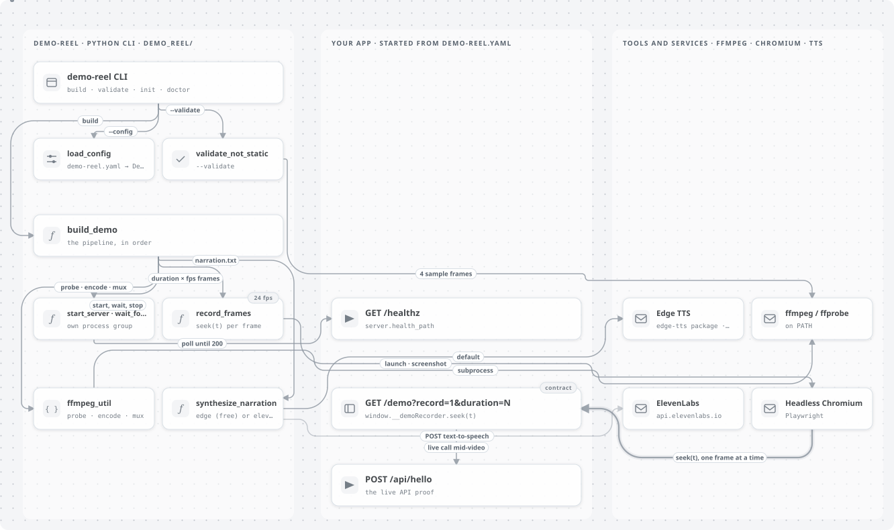

# Architecture

## Pipeline

<picture>
  <source media="(prefers-color-scheme: dark)" srcset="diagrams/pipeline.dark.svg">
  
</picture>

1. **Narration** — plain text → Edge TTS (free) or ElevenLabs → MP3
2. **Duration** — ffprobe reads MP3 length; drives frame count
3. **Server** — subprocess starts app from `demo-reel.yaml` `server.command`
4. **Capture** — Playwright opens `/demo?record=1&duration=N`, calls `seek(t)` per frame, PNG screenshots
5. **Encode** — ffmpeg frames → H.264 silent MP4
6. **Mux** — silent video + narration → final MP4
7. **Validate** — sample frames must differ (not a static image)

<picture>
  <source media="(prefers-color-scheme: dark)" srcset="diagrams/build-run.dark.svg">
  
</picture>

Both diagrams are rendered by [PR Lens](https://github.com/coldteadotai/pr-lens) from `diagrams/pipeline.graph.json`; the same tool draws every pull request (see `.github/workflows/pr-lens.yml`).

## Why seek-based capture?

Playwright's built-in video recorder captures the compositor output but long `waitForTimeout` pads produce visually static output. Seek-based capture guarantees every frame reflects the intended animation state.

## CI/CD

Attach `dist/demo.mp4` to GitHub Releases on tag push. Use `tts: edge` in CI (no API key). Cache Playwright browsers between runs.

## Extension points

- Custom TTS backends in `demo_reel/tts.py`
- Keyframe JSON loader (v0.2)
- Auto-narration from CHANGELOG (v0.2)
